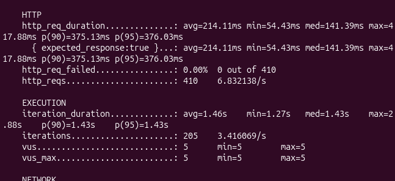
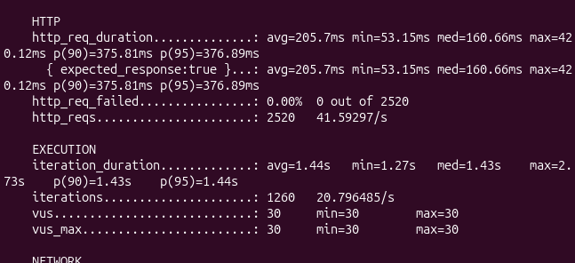
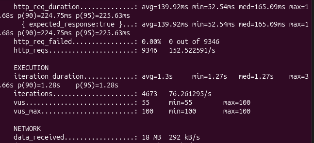

# Лаб 2: k6 гүйцэтгэлийн хэмжилт
Зоригтбаатар, B242270078

## Зорилго
k6 ашиглан latency (p90/p95), throughput, error rate-ийг бодитоор хэмжиж, ачаалал өсөхөд гүйцэтгэл хэрхэн өөрчлөгдөхийг ажиглах. Тест хийсэн бай: https://test.k6.io (зааврын албан ёсны дадлагын сайт) болон өөрийн локал Express сервер (http://localhost:3000). Өөр сайт руу тест хийгээгүй.

## k6 version

    k6 v2.4.0 (commit/dd9395906d, go1.26.11, linux/amd64)

## Файлууд
- `script.js`: test.k6.io руу 5 VU (stages-гүй), 30 ба 100 VU-г `--vus` флагаар ажиллуулсан
- `stages.js`: ачаалал шатлан өсгөх тест (ерөнхий зураг, хүснэгтэд ороогүй)
- `server.js`: Express сервер (`/fast`, `/slow` = 100 мс хоцрогдолтой)
- `local.js`: локал сервер рүү baseline тест
- `strict.js`: хатуу threshold (FAIL гаргах)
- `slo.js`: өөрийн baseline-аас гаргасан SLO (PASS гаргах)
- `results/`: k6-ийн бүтэн текст гаралтууд
- `screenshots/`: summary-ийн дэлгэцийн зургууд

## Хэмжилтийн хүснэгт (https://test.k6.io, 1 минут тус бүр)

| VU | p90 | p95 | Throughput (req/s) | Нийт хүсэлт | Error rate | Файл |
|----|-----|-----|--------------------|-------------|-----------|------|
| 5   | 375.13 мс | 376.03 мс | 6.83   | 410  | 0.00% | results/run-05vu.txt |
| 30  | 375.81 мс | 376.89 мс | 41.59  | 2520 | 0.00% | results/run-30vu.txt |
| 100 | 224.75 мс | 225.63 мс | 152.52 | 9346 | 0.00% | results/run-100vu.txt |

Хүснэгтийн тоо нь гурван тусдаа ажиллуулалтаас (`k6 run --vus N --duration 1m script.js`) авсан. `results/run-stages.txt` нь stages-тэй ажиллуулалт бөгөөд хүснэгтэд ороогүй.

## Локал серверийн baseline ба SLO

Локал `/slow` endpoint (100 мс хоцрогдолтой) руу 5 VU-ээр 30 секунд хийсэн ажиллуулалт (results/local-slow.txt):
- p90 = 103.54 мс, **p95 = 104.1 мс (baseline)**, avg = 102.57 мс
- 140 хүсэлт, 4.53 req/s, error rate 0.00%

**SLO:**
- `http_req_duration`: p(95) < 156 мс
- `http_req_failed`: rate < 1%

**Үндэслэл:** SLO-г baseline p95 × 1.5 = 104.1 × 1.5 ≈ 156 мс гэж тогтоосон. Серверийн хариу нь 100 мс-ийн хиймэл хоцрогдолтой тул ачаалал нэмэгдэхэд гарах хэвийн хэлбэлзлийг зөвшөөрч, харин бодит удаашралыг (жишээ нь 50%-иас дээш) барих хэмжээ юм. Гадаад сайт (test.k6.io) нь сүлжээнээс хамаарч тогтворгүй тул SLO-г локал серверийн baseline-аар тогтоосон.

## Threshold: PASS ба FAIL (30 VU, 1 минут, локал /slow)

| Тест | Threshold | Үр дүн | Файл |
|------|-----------|--------|------|
| strict.js | p(95) < 50 мс | **FAIL**: p(95) = 104.88 мс, `thresholds on metrics 'http_req_duration' have been crossed` | results/threshold-fail.txt |
| slo.js | p(95) < 156 мс | **PASS**: p(95) = 104.05 мс | results/threshold-pass.txt |

Хоёр тестэд `http_req_failed` нь 0.00% (rate<0.01 хангагдсан), нийт 1650 хүсэлт.

## Дүгнэлт

Ачаалал 5 VU-аас 100 VU хүртэл өсөхөд throughput 6.83-аас 41.59, 152.52 req/s болж бараг шугаман өссөн (VU 6 дахин нэмэгдэхэд 6.1 дахин, дараа нь 3.3 дахин нэмэгдэхэд 3.7 дахин). Скриптэд `sleep(1)` байгаа тул throughput нь VU-ийн тоогоор дээд хязгаарлагддаг бөгөөд test.k6.io 100 VU хүртэл ачааллыг дааж, хязгаардаа хүрээгүй байна. Харин p95 latency 5 VU дээр 376.03 мс, 30 VU дээр 376.89 мс байсан бол 100 VU дээр 225.63 мс болж буурсан тул лекцийн «ачаалал өсөхөд latency өснө» гэсэн таамаглал энэ хэмжилтэд батлагдсангүй. Үүнийг гадаад сайт, сүлжээний хэлбэлзэл, гурван ажиллуулалтыг өөр өөр цагт хийсэн, сервер талын cache зэрэг хүчин зүйл нөлөөлсөн байж болно гэж таамаглаж байгаа ч шалгаагүй. Error rate бүх түвшинд 0.00% байсан тул p95 болон error rate-ээр хэрэглэгчийн туршлага муудсан цэгийг 100 VU хүртэл олж чадсангүй, үүнийг илрүүлэхийн тулд өндөр VU-тэй тест хэрэгтэй. Лекцийн ойлголтуудаас throughput болон latency нь хоёр тусдаа хэмжүүр бөгөөд нэгийг нь дангаар харахад чанарыг дүгнэх боломжгүй гэдэг батлагдсан: 100 VU дээр throughput хамгийн өндөр байхад p95 нь хамгийн бага байв. Мөн нэг iteration-д 2 хүсэлт тоологдсон (5 VU: 205 iteration, 410 хүсэлт), энэ нь redirect-ээс болсон байж болох тул req/s нь iteration/s-ээс 2 дахин их гарсан. Гадаад сайтын хэмжилт тогтворгүй тул SLO болон threshold-ыг локал Express сервер дээр хийсэн бөгөөд локал baseline p95 нь 104.1 мс (100 мс хоцрогдол + бага зэргийн нэмэлт) байв. SLO-г baseline × 1.5 = 156 мс болгон тогтоож, 30 VU дээр p95 = 104.05 мс гарснаар SLO хангагдсан (PASS). Хатуу threshold p(95)<50 мс нь p95 = 104.88 мс-тэй зөрчигдөж тест FAIL болсон бөгөөд k6 алдааны кодтойгоор дууссан. Яг ийм зарчмаар CI pipeline дээр quality gate нь threshold зөрчигдвөл build-ийг автоматаар зогсоодог.

## Дэлгэцийн зургууд

